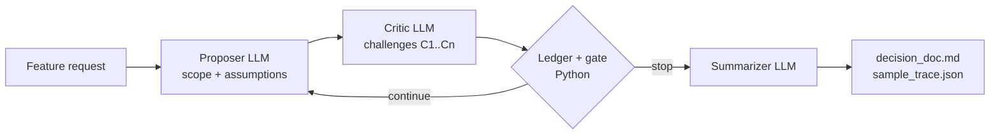

# The Deliberation Engine

A Proposer agent and a Critic agent debate a vague Government CRM feature request until a deterministic Python gate ends the debate. A Summarizer then turns the settled issue ledger into a structured decision document: agreed scope (in and out), surfaced assumptions, and open questions that need a human decision.

## Architecture



- **Proposer** (`prompts/proposer.md`): proposes a lean v1 scope with explicit assumptions `A1..An`, tags each in-scope item with the assumptions it relies on, then defends, revises, or concedes each challenge by weighing the cost of the Critic's fix against the risk left if v1 ships without it.
- **Critic** (`prompts/critic.md`): raises specific challenges `C1..Cn` against those assumptions (confidentiality, least privilege, staff turnover, alert fatigue), then accepts, keeps challenging, or escalates policy questions to humans.
- **Ledger + gate** (`src/engine.py`): Python owns each issue's state (`CHALLENGED` → `DEFENDED` / `REVISED` / `CONCEDED` → `ACCEPTED` / `ESCALATED_TO_HUMAN`), computes a disagreement score, and decides when to stop. It never stops in round 1, stops once every issue is settled, escalates an issue as deadlocked from round 3 only when the Critic explicitly re-challenges an answer the Proposer gave that same round, reopens an accepted issue if the Proposer later changes the assumption it targets, and enforces a `--max-rounds` ceiling that labels one-sided issues (never answered, or answered but never reviewed) separately from real stalemates.
- **Summarizer** (`prompts/summarizer.md`): writes only prose: the executive summary, assumption notes, and the wording of each open question. Python builds every fact in the document from the ledger and the Proposer's final structured scope: included scope, scope pending a human decision (items tied to an assumption that an escalated issue targets), exclusions, success criteria, assumption dispositions, exactly one open question per escalated issue, the metrics, and an issue-ledger table. Any mismatch in the Summarizer's output is logged in the trace as `summary_corrections`.

The reasoning behind the prompts and stopping rules is in [DECISIONS.md](DECISIONS.md).

## Setup (Python 3.9+)

```bash
python3 -m venv .venv
source .venv/bin/activate
pip install -r requirements.txt
cp .env.example .env   # then put your OpenRouter key in LLM_API_KEY
```

| Variable | Value in `.env.example` |
|---|---|
| `LLM_API_KEY` | your OpenRouter API key |
| `LLM_BASE_URL` | `https://openrouter.ai/api/v1` |
| `PROPOSER_MODEL`, `CRITIC_MODEL`, `SUMMARIZER_MODEL` | `anthropic/claude-sonnet-5.5` |

Any OpenAI-compatible endpoint works, as long as the models support structured outputs (JSON schema).

## Usage

```bash
python3 -m src.main --request "We need a better way to track who is the right person to contact in each country."
python3 -m src.main --config config.example.json         # reads "feature_request" from the JSON file
python3 -m src.main --request "..." --max-rounds 5       # default 4, minimum 2
python3 -m src.main --request "..." --output-dir runs/   # default outputs/
```

With neither `--request` nor `--config`, it runs official example 1. Each round prints a Proposer panel and a Critic panel with the disagreement score and gate status. At the end it prints the decision document and writes `decision_doc.md` and `sample_trace.json` to the output directory.

## Tests

```bash
python3 -m unittest discover -s tests
```

Thirteen offline state-machine tests drive the engine with scripted Proposer and Critic turns (no API key needed). They cover convergence, deadlock escalation, the round-3 reply window, deadlock requiring a fresh rejection, terminal-state locking, reopening when an accepted assumption changes, concession handling, the gate-close fallback, the max-rounds labels, and a deliberately wrong Summarizer draft that cannot change any ledger fact.

## Golden runs (`outputs/`)

| Files | Request | Rounds | Disagreement score | Defended in round 2 | Escalated to humans | Scope pending a human decision |
|---|---|---|---|---|---|---|
| `example1_right_contact_*` | Track who is the right person to contact in each country | 2 | 0.89 → 0.0 | 0 of 4 | none | 0 of 9 items |
| `example2_country_history_*` | Project managers see full engagement history before a new mission | 2 | 0.87 → 0.0 | 1 of 5 | C4, C5 | 4 of 8 items |
| `example3_relationship_cold_*` | Alert when a relationship with a country goes cold | 3 | 0.88 → 0.12 → 0.0 | 1 of 5 (re-challenged, then revised in round 3) | C4 | 3 of 9 items |

All three ended with `CONVERGENCE_ALL_ISSUES_RESOLVED_OR_ESCALATED (CRITIC_SIGNALED_CONVERGENCE)`, and the Summarizer's draft needed no corrections in any of them (`summary_corrections` is empty). Each example has a `_trace.json` (every round plus ledger snapshots), a `_decision.md` (the final document), and a `_console.log` (the console output). `sample_trace.json` and `decision_doc.md` are copies of example 3, which shows the round-1 lock, a continue round, a defense the Critic rejected, a policy escalation, and scope held back for a human decision. Deadlock, reopening, and the max-rounds labels did not occur in these runs; the offline tests cover them. All runs used `anthropic/claude-sonnet-5.5` for all three agents.

## Layout

```text
prompts/   proposer.md, critic.md, summarizer.md
src/       schemas.py (Pydantic contracts, state weights), engine.py (loop, ledger, gate), main.py (CLI)
tests/     test_engine.py (offline state-machine tests)
outputs/   golden runs
```
