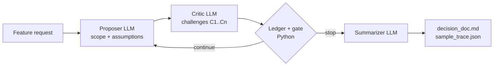

# The Deliberation Engine

A Proposer agent and a Critic agent debate a vague Government CRM feature request until a deterministic Python gate ends the debate. A Summarizer then turns the settled issue ledger into a structured decision document: agreed scope (in and out), surfaced assumptions, and open questions that need a human decision.

## Architecture



- **Proposer** (`prompts/proposer.md`): proposes a lean v1 scope with explicit assumptions `A1..An`, then defends, revises, or concedes each challenge while protecting a complexity budget.
- **Critic** (`prompts/critic.md`): raises specific challenges `C1..Cn` against those assumptions (confidentiality, least privilege, staff turnover, alert fatigue), then accepts, keeps challenging, or escalates policy questions to humans.
- **Ledger + gate** (`src/engine.py`): Python owns each issue's state (`CHALLENGED` → `DEFENDED` / `REVISED` / `CONCEDED` → `ACCEPTED` / `ESCALATED_TO_HUMAN`), computes a disagreement score, and decides when to stop. It never stops in round 1, stops once every issue is settled, escalates deadlocked issues from round 3, and enforces a `--max-rounds` ceiling.
- **Summarizer** (`prompts/summarizer.md`): writes the final document from the ledger and trace. The engine then overwrites its score, confidence, and termination fields with its own values.

The reasoning behind the prompts and stopping rules is in [DECISIONS.md](DECISIONS.md).

## Setup (Python 3.9+)

```bash
python3 -m venv .venv
source .venv/bin/activate
pip install -r requirements.txt
cp .env.example .env   # then put your OpenRouter key in LLM_API_KEY
```

| Variable | Value in `.env.example` |
|---|---|
| `LLM_API_KEY` | your OpenRouter API key |
| `LLM_BASE_URL` | `https://openrouter.ai/api/v1` |
| `PROPOSER_MODEL`, `CRITIC_MODEL`, `SUMMARIZER_MODEL` | `anthropic/claude-sonnet-5.5` |

Any OpenAI-compatible endpoint works, as long as the models support structured outputs (JSON schema).

## Usage

```bash
python3 -m src.main --request "We need a better way to track who is the right person to contact in each country."
python3 -m src.main --config config.example.json         # reads "feature_request" from the JSON file
python3 -m src.main --request "..." --max-rounds 5       # default 4, minimum 2
python3 -m src.main --request "..." --output-dir runs/   # default outputs/
```

With neither `--request` nor `--config`, it runs official example 1. Each round prints a Proposer panel and a Critic panel with the disagreement score and gate status. At the end it prints the decision document and writes `decision_doc.md` and `sample_trace.json` to the output directory.

## Tests

```bash
python3 -m unittest discover -s tests
```

Eight offline state-machine tests drive the engine with scripted Proposer and Critic turns (no API key needed). They cover convergence, deadlock escalation, terminal-state locking, concession handling, the gate-close fallback, the max-rounds failsafe, and the engine overwriting the Summarizer's metrics.

## Golden runs (`outputs/`)

| Files | Request | Rounds | Disagreement score | Termination | Open questions |
|---|---|---|---|---|---|
| `example1_right_contact_*` | Track who is the right person to contact in each country | 3 | 0.88 → 0.10 → 0.0 | `CONVERGENCE_ALL_ISSUES_RESOLVED_OR_ESCALATED (CRITIC_SIGNALED_CONVERGENCE)` | 1 |
| `example2_country_history_*` | Project managers see full engagement history before a new mission | 3 | 0.88 → 0.12 → 0.0 | `CONVERGENCE_ALL_ISSUES_RESOLVED_OR_ESCALATED (CRITIC_SIGNALED_CONVERGENCE)` | 2 |
| `example3_relationship_cold_*` | Alert when a relationship with a country goes cold | 3 | 0.88 → 0.12 → 0.0 | `DEADLOCK_ESCALATED_TO_HUMAN (C2)` | 2 |

Each example has a `_trace.json` (every round plus ledger snapshots), a `_decision.md` (the final document), and a `_console.log` (the console output). `sample_trace.json` and `decision_doc.md` are copies of example 3, which exercises the round-1 lock, a continue round, a policy escalation, and the deadlock breaker. All runs used `anthropic/claude-sonnet-5.5` for all three agents.

## Layout

```text
prompts/   proposer.md, critic.md, summarizer.md
src/       schemas.py (Pydantic contracts, state weights), engine.py (loop, ledger, gate), main.py (CLI)
tests/     test_engine.py (offline state-machine tests)
outputs/   golden runs
```
